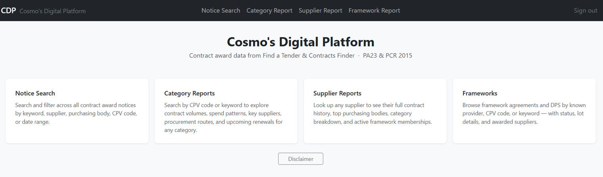
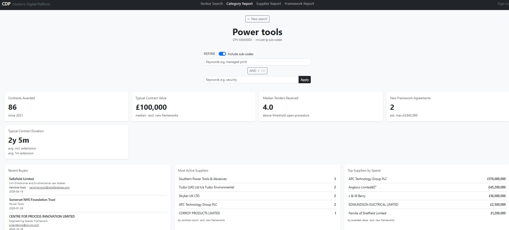
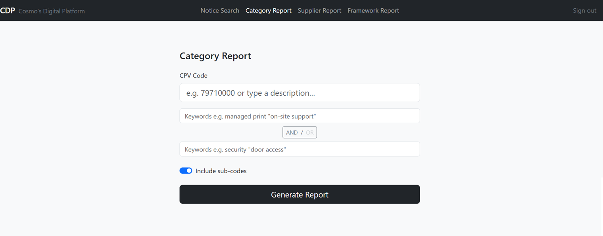
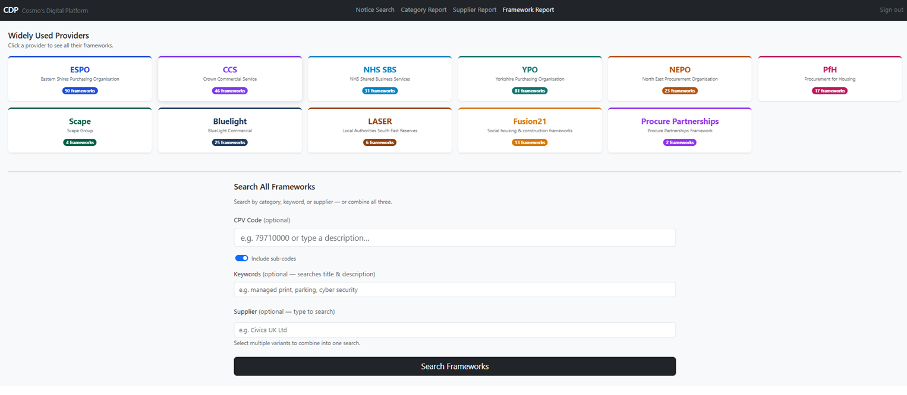
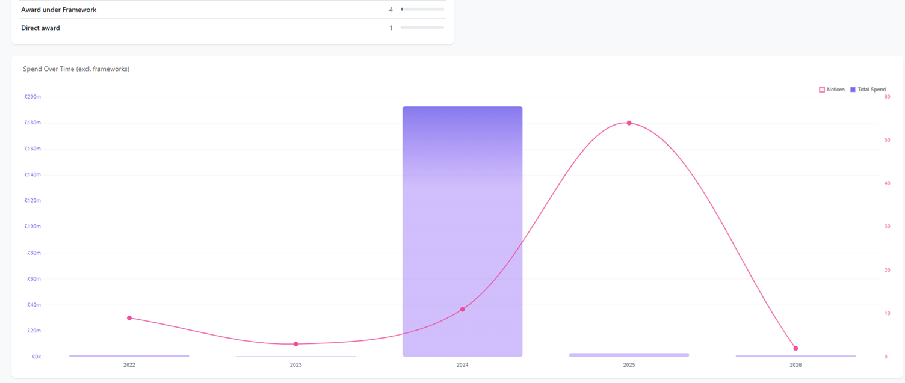

# CDP — Procurement Intelligence Platform

A full-stack data platform that ingests UK public-sector procurement notices from
government APIs, normalises them into a queryable analytical database, and serves
a web application for exploring spend patterns, frameworks, suppliers and buyers.

Built to answer practical questions that are hard to get out of the official portals:
*Which suppliers dominate a category? Which frameworks are still active? When does
a contract come up for renewal? How many tenders does a typical procurement attract?*

---

## What it does

- **Ingests** notices from the [Find a Tender Service](https://www.find-tender.service.gov.uk/)
  (the UK's post-2024 Procurement Act system) and [Contracts Finder](https://www.contractsfinder.service.gov.uk/)
  (the older PCR2015 system), normalising both into one consistent schema despite
  their very different data shapes.
- **Stores** everything in [DuckDB](https://duckdb.org/) — an embedded analytical
  database that makes it possible to run complex aggregate queries over millions of
  rows of award/contract data with sub-second response times, no server required.
- **Serves** an interactive web app (FastAPI + Jinja2 + Bootstrap) with several
  report types:
  - **CPV category reports** — search by procurement category, see spend trends,
    procurement routes used, top suppliers, competition levels, and upcoming
    contract renewals
  - **Supplier reports** — a supplier's full win history, typical contract values,
    buyer relationships, and active framework positions
  - **Framework tracker** — surfaces active/likely-active framework agreements,
    grouped by known framework providers (CCS, ESPO, YPO, NEPO, etc.), with
    lot-level breakdowns of appointed suppliers
  - **Full-text notice search** — keyword + category + supplier + date filtering
    across the full notice corpus

## Screenshots

| | |
|---|---|
| **Homepage**  | **Category report**  |
| **Category search**  | **Framework search**  |
| **Example visualisation**  | |

## Architecture

```
                 ┌──────────────────────┐
                 │   Government APIs    │
                 │  FTS  ·  Contracts   │
                 │       Finder         │
                 └──────────┬───────────┘
                            │  OCDS JSON (raw)
                            ▼
                 ┌──────────────────────┐
                 │   Ingestion layer    │   connectors/, ingest.py
                 │  (Python, requests)  │   — pulls, paginates, delta-syncs
                 └──────────┬───────────┘
                            │
                            ▼
                 ┌──────────────────────┐
                 │   Extraction layer   │   db/extractor.py + extract_*.py
                 │  normalise OCDS →    │   — handles two very different
                 │  flat relational     │      source schemas, framework/lot
                 │  schema              │      structures, supplier appointments
                 └──────────┬───────────┘
                            │
                            ▼
                 ┌──────────────────────┐
                 │       DuckDB         │   data.duckdb
                 │  (notices, raw JSON) │   — millions of rows, analytical queries
                 └──────────┬───────────┘   in milliseconds
                            │
                            ▼
                 ┌──────────────────────┐
                 │   FastAPI web app    │   web/app.py
                 │  Jinja2 + Bootstrap  │   — auth, search, reports, JSON APIs
                 └──────────┬───────────┘      for infinite-scroll lists
                            │
                            ▼
                 ┌──────────────────────┐
                 │  nginx + systemd     │   production deployment
                 │  Let's Encrypt SSL   │   (Ubuntu / Hetzner Cloud VPS)
                 └──────────────────────┘
```

## Tech stack

| Layer | Technology |
|---|---|
| Ingestion | Python, `requests`, custom OCDS connectors |
| Storage | DuckDB (embedded analytical/columnar database) |
| Backend | FastAPI, Jinja2, session-based auth |
| Frontend | Bootstrap 5, vanilla JS (autocomplete, infinite scroll, cursor tooltips) |
| Deployment | nginx (reverse proxy + TLS), systemd, uvicorn, Let's Encrypt |

## Running it locally

```bash
pip install -r requirements.txt
```

Create a `.env` file in the project root:

```
ADMIN_USER=admin
ADMIN_PASS=changeme
SECRET_KEY=generate-a-random-secret-key   # signs session cookies — use a long random string
```

Both data sources (Find a Tender Service and Contracts Finder) are public,
unauthenticated endpoints — no API keys needed to pull data.

**1. Pull some data** (e.g. CPV 79710000 — security services, last 365 days):

```bash
python ingest.py --cpv 79710000 --days 365
```

**2. Run the web app:**

```bash
python run_web.py        # or: uvicorn web.app:app --reload
```

Then visit `http://127.0.0.1:9000`.

**3. Keep the data fresh** with a delta sync (pulls only what's changed since last run):

```bash
python ingest.py --sync
```

## Project structure

```
fts_researcher/
├── ingest.py                    # CLI: pull releases from the live FTS/CF APIs
├── ocp_ingest.py                # CLI: pull PA23 notices from OCP bulk downloads
├── run_web.py                   # Starts the FastAPI dev server
│
├── connectors/                  # API clients for each data source
│   ├── fts.py                   #   Find a Tender Service (PA23, OCDS)
│   └── contracts_finder.py      #   Contracts Finder (PCR2015, OCDS)
│
├── db/
│   ├── schema.py                # DuckDB schema definition
│   ├── store.py                 # Upsert / query helpers
│   ├── extractor.py             # OCDS → relational extraction logic
│   └── extract_*.py             # Regime-specific extraction (PA23 frameworks,
│                                #   PCR2015 awards, supplier appointments, etc.)
│
├── utils/
│   └── delta.py                 # Last-run timestamp tracking for incremental syncs
│
├── web/
│   ├── app.py                   # FastAPI routes, auth, all report query logic
│   ├── templates/               # Jinja2 templates (search forms, reports, details)
│   └── static/                  # CSS
│
├── data/
│   ├── cpv_lookup.json          # CPV code → description lookup
│   └── framework_providers.json # Known framework provider definitions
│
├── raw/                         # Raw JSON responses, saved per pull (gitignored)
├── data.duckdb                  # Local database (gitignored — generated by ingestion)
└── .env                         # API keys & secrets (gitignored)
```

## Data source notes

Both APIs return [OCDS](https://standard.open-contracting.org/) (Open Contracting
Data Standard) JSON, but with meaningfully different shapes — reconciling them into
one schema was most of the engineering challenge here:

**Find a Tender Service (FTS / PA23)**
- Richer, more structured data — notice type lives in `tender.procurementMethodDetails`
- Auth via `CDP-Api-Key` header; cursor-based pagination
- Delta sync via `updatedFrom` / `updatedTo`

**Contracts Finder (CF / PCR2015)**
- Simpler structure — notice type lives in a `tag` array on each release
- No auth required; rate-limited (403 on excess — back off ~5 minutes)
- Delta sync via `publishedFrom` / `publishedTo`

The `ocid` field is the stable identifier for a procurement process across its
lifecycle (planning → tender → award releases). Both raw releases and extracted,
flattened notice records are stored, linked by `ocid` / `release_id`, so the
original source JSON is always available for reference (e.g. resolving the correct
external notice URL, which sometimes requires digging into nested award documents).

## Production deployment

Runs on a small Ubuntu VPS: `uvicorn` behind `nginx` (reverse proxy + Let's Encrypt
TLS termination), managed as a `systemd` service for automatic restarts. Session
auth is environment-configurable so the same codebase can run open (for local dev /
trusted environments) or behind a login (for shared deployments).
